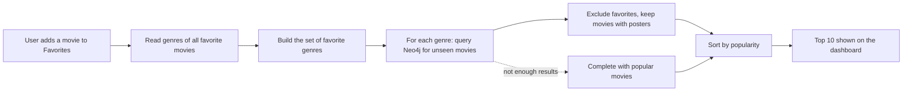
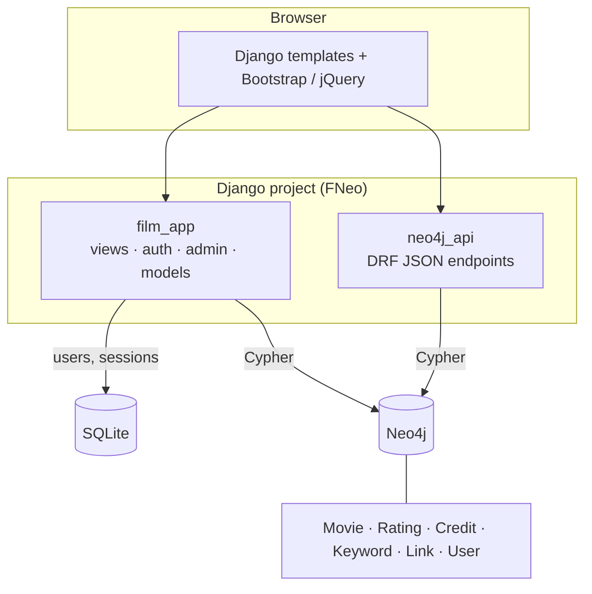

<div align="center">

# 🎬 FilmNeo — Movie Recommendation System with Neo4j

**A Django web app that stores movies, credits, keywords and ratings in a Neo4j graph database and recommends films based on what you love.**


</div>

---

## ✨ Features

| | Feature | Description |
|---|---|---|
| 🏠 | **Home & discovery** | Trending, popular and top-rated movies served straight from the graph |
| 🔎 | **Search & filters** | Full-text search, category browsing, paginated movie list |
| 🎞️ | **Movie details** | Overview, genres, cast & crew, keywords, external links, similar movies |
| ⭐ | **Ratings** | Rate any movie; ratings are stored as `Rating` nodes in Neo4j |
| ❤️ | **Favorites & Watchlist** | One-click toggle, dedicated pages, live counters |
| 🤖 | **Personalized recommendations** | Suggestions computed from the genres of your favorite movies |
| 👤 | **Authentication** | Register / login / profile, custom `User` model synced to Neo4j |
| 🛠️ | **Admin dashboard** | Manage users, activate/deactivate accounts, grant or revoke admin rights |
| 🔌 | **REST API** | JSON endpoints for movies, credits, keywords, similar movies and ratings |

## 🧠 How the recommendation works



- **No favorites yet?** → the user gets the most popular movies (cold start).
- **With favorites** → genres are extracted from the favorite movies, then Neo4j returns the most popular movies sharing those genres, excluding anything already liked.
- **Similar movies** (`/api/movies/<id>/similar/`) → movies sharing at least one genre with the current film, ordered by popularity.

```cypher
MATCH (m:Movie)
WHERE NOT m.id IN $favorite_ids
  AND m.poster_path IS NOT NULL
  AND toLower(m.genres) CONTAINS $genre_name
RETURN DISTINCT m.id AS id, m.original_title AS title, m.popularity AS popularity
ORDER BY m.popularity DESC
LIMIT $sublimit
```

---

## 🏗️ Architecture



**Graph model (nodes):** `Movie`, `Rating`, `Credit`, `Keyword`, `Link`, `User`

**Stack:** Python · Django · Django REST Framework · Neo4j (Bolt driver) · SQLite · HTML/CSS/JS (Bootstrap, jQuery, OwlCarousel) · TMDB poster CDN

---

## 📁 Project structure

```
RecommandationSysOfFilmsWithNeo4j/
├── FNeo/                 # Django project (settings, urls, wsgi/asgi)
├── film_app/             # Main app: pages, auth, favorites, watchlist, admin
│   ├── templates/        # home, movies, movie_detail, favorites, watchlist, dashboard…
│   ├── models.py         # Custom User + recommendation logic
│   ├── views.py          # Public & user views
│   ├── auth_views.py     # Register / login / profile
│   ├── admin_views.py    # Admin dashboard & user management
│   └── management/commands/setup_database.py
├── neo4j_api/            # REST API over Neo4j (movies, ratings, search…)
├── utils/                # Neo4j connection helper
├── static/               # CSS, JS, images
├── test_connection.py    # Neo4j connectivity check
├── test_neo4j.py
└── manage.py
```

---

## 🚀 Getting started

### 1. Prerequisites
- Python 3.10+
- [Neo4j Desktop](https://neo4j.com/download/) or Neo4j Server (running on `bolt://localhost:7687`)
- A Neo4j database already loaded with the movie dataset (`Movie`, `Rating`, `Credit`, `Keyword`, `Link` nodes)

### 2. Clone & install
```bash
git clone https://github.com/HraphDev/RecommandationSysOfFilmsWithNeo4j.git
cd RecommandationSysOfFilmsWithNeo4j

python -m venv venv
source venv/bin/activate        # Windows: venv\Scripts\activate

pip install django djangorestframework neo4j python-dotenv
```

### 3. Configure environment
Create a `.env` file at the project root (**never commit it**):
```env
NEO4J_URI=neo4j://127.0.0.1:7687
NEO4J_USER=neo4j
NEO4J_PASSWORD=your_password_here
```

### 4. Initialize & run
```bash
python manage.py migrate
python manage.py setup_database     # tests Neo4j, creates constraints + an admin account
python manage.py runserver
```
Open **http://127.0.0.1:8000** 🎉

> ⚠️ `setup_database` creates a default `admin` account. **Change its password immediately** after the first login.

---

## 🔌 API reference

Base path: `/api/`

| Method | Endpoint | Description |
|---|---|---|
| GET | `movies/<id>/` | Short movie info |
| GET | `movies/<id>/full/` | Full movie details |
| GET | `movies/<id>/credits/` | Cast & crew |
| GET | `movies/<id>/keywords/` | Keywords |
| GET | `movies/<id>/links/` | IMDb / TMDB ids |
| GET | `movies/<id>/similar/` | 12 similar movies (shared genres) |
| GET | `movies/search/?q=` | Search movies |
| GET | `movies/popular/` | Most popular movies |
| GET | `movies/top-rated/` | Best-rated movies |
| GET | `ratings/<movie_id>/user/<user_id>/` | A user's rating for a movie |
| POST | `ratings/<movie_id>/user/<user_id>/add/` | Add / update a rating |
| POST | `favorites/toggle/` | Toggle a favorite |
| POST | `watchlist/toggle/` | Toggle watchlist entry |

---

## 🗺️ Roadmap

- [ ] Collaborative filtering (users who liked X also liked Y) using `Rating` relationships
- [ ] Hybrid score: genres + keywords + cast/crew similarity
- [ ] Graph Data Science (Neo4j GDS) node similarity
- [ ] Docker Compose (Django + Neo4j)
- [ ] Unit tests & CI

---

## 👨‍💻 Author

**Achraf** — [GitHub @HraphDev](https://github.com/HraphDev) · [LinkedIn](https://linkedin.com/in/achraf-bouhia-606154234)

⭐ If you like this project, give it a star!
